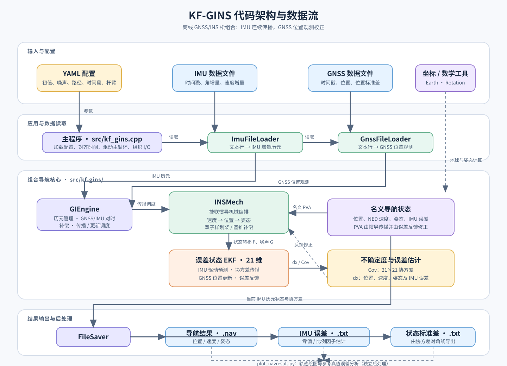
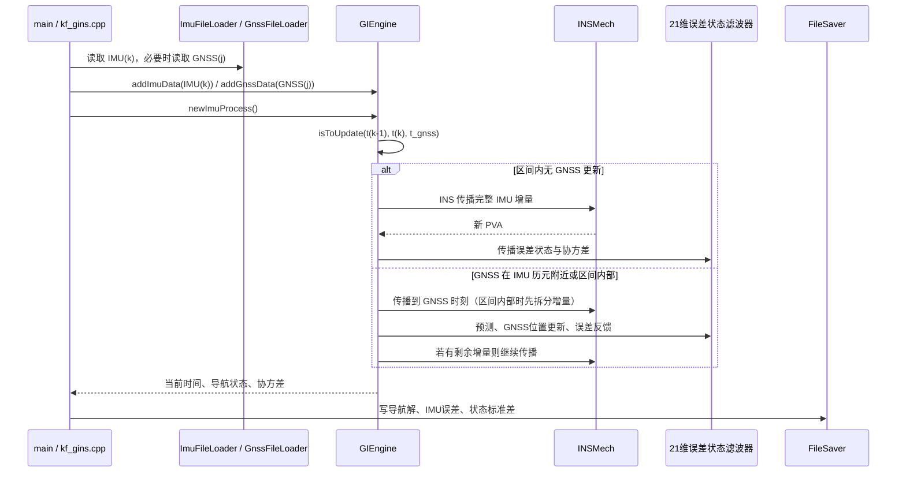

# KF-GINS 项目逻辑架构

本文依据当前仓库中的 C++ 实现整理，聚焦程序启动、数据流、惯导机械编排、误差状态 EKF、配置及结果输出。它是代码导读，不替代算法论文或课程讲义。主要实现入口为 `src/kf_gins.cpp`，滤波与数据时标管理位于 `src/kf-gins/gi_engine.*`。

## 1. 项目定位与整体结构

KF-GINS 是一个离线运行的 GNSS/INS 松组合导航程序：IMU 提供高频增量，用于连续惯导解算和滤波预测；GNSS 提供低频位置观测，用于误差状态校正。程序采用误差状态扩展卡尔曼滤波（ES-EKF），每个 IMU 历元推进一次主循环，GNSS 观测到达时在对应时刻更新。



若当前 Markdown 查看器不显示图片，可[直接打开 SVG 图](./KF-GINS-Architecture.svg)。

### 目录与职责

| 路径 | 职责 |
|---|---|
| `src/kf_gins.cpp` | 程序入口；读取 YAML、构造选项和引擎、对齐/馈送数据、控制处理区间、保存结果。 |
| `src/kf-gins/gi_engine.h/.cpp` | 组合导航核心；管理 IMU/GNSS 时标、IMU 误差补偿、INS 传播、EKF 预测/更新和误差反馈。 |
| `src/kf-gins/insmech.h/.cpp` | 纯惯导机械编排；由 IMU 增量更新速度、位置和姿态。 |
| `src/kf-gins/kf_gins_types.h` | 导航状态、IMU 误差、噪声模型及 `GINSOptions` 等算法类型。 |
| `src/common/types.h` | 通用 `IMU`、`GNSS`、`Pose` 数据结构。 |
| `src/common/earth.h` | WGS-84 参数、重力、曲率半径、坐标转换与地球/导航系角速度等。 |
| `src/common/rotation.h`, `angle.h` | 姿态表示转换、旋转向量/四元数、反对称矩阵及角度单位换算。 |
| `src/fileio/` | 通用文本/二进制文件读取与写入，以及 IMU、GNSS 专用适配器。主程序使用文本格式。 |
| `config/`, `dataset/` | 示例配置及数据。`dataset/kf-gins.yaml` 是可运行示例配置。 |
| `scripts/plot_navresult.py` | 读取导航、误差和标准差输出，绘图并可与参考真值比较。 |
| `ThirdParty/` | Eigen、yaml-cpp、abseil-cpp；由顶层 CMake 集成。 |

## 2. 启动与主程序控制流

入口 `main(argc, argv)` 只接受一个配置文件参数，执行顺序如下：

1. **读取并校验配置文件**：yaml-cpp 加载 YAML；`loadConfig()` 将初始导航状态、初始标准差、IMU 噪声和天线杆臂复制到 `GINSOptions`，同时把常用工程单位换算为内部单位。
2. **读取文件及区间参数**：取得 `imupath`、`gnsspath`、`outputpath`、IMU 数据列数/标称频率和处理起止时刻。
3. **构造资源**：建立 `GnssFileLoader`、`ImuFileLoader` 和 `GIEngine`，并打开三个结果文件。输出文件夹不会由程序创建，须事先存在。
4. **检查输入输出文件和处理区间**：结束时间小于 0 时采用 IMU 文件的结束时间；代码还检查结束时间不超过一周秒数、起始时间不早于 IMU 起点且不晚于结束时间。
5. **初始时间对齐**：
   - 顺序读取 IMU，直到第一个 `imu.time >= starttime` 的历元；
   - 顺序读取 GNSS，跳过所有 `gnss.time <= starttime` 的观测，因此仅使用严格晚于起始时刻的 GNSS 记录；
   - 将首个 IMU 以 `compensate=true` 加入引擎，并加入首个 GNSS 观测。
6. **逐 IMU 历元处理**：若当前 GNSS 时刻早于当前 IMU 时刻且 GNSS 文件未结束，则取下一条 GNSS 并加入引擎；读取下一条 IMU，遇到结束时间或 EOF 后退出；否则加入 IMU 并调用 `newImuProcess()`。
7. **保存并结束**：从引擎读取时间戳、导航状态和协方差，写出三类结果；关闭文件并打印处理时长。

主程序与引擎的职责边界是：主程序负责**数据源读取、主循环和 I/O**，引擎负责**状态估计与时间同步**。GNSS 数据被缓存到引擎中，且每次被消费后标记为无效；主循环不会在每个 IMU 周期重复使用同一观测。

## 3. 数据结构及内部单位

### 导航状态

`PVA` 将位置、速度和姿态组合起来；姿态内部同时保存四元数 `qbn`、方向余弦矩阵 `cbn` 和欧拉角 `euler`。`NavState` 面向配置及输出，保存位置、速度、欧拉角和 IMU 误差。

- **位置**：大地纬度、经度、高程；内部纬经度为弧度，高程为米。
- **速度**：导航系 NED（北、东、地/向下）分量，单位 m/s。
- **姿态**：机体系到导航系的姿态；欧拉角为 ZYX 顺序，分量 roll、pitch、yaw，内部为弧度。
- **IMU 误差**：陀螺/加速度计三轴零偏和比例因子。
- **IMU 观测**：时间戳、采样间隔、角增量 `dtheta`、速度增量 `dvel`。机械编排使用增量而非角速度/比力原始采样值。
- **GNSS 观测**：时间戳、大地坐标 `blh`、三轴位置标准差和有效标志；输入纬经度从度转换为弧度。

### 配置输入单位换算

`loadConfig()` 完成以下转换，故引擎收到的参数应视为 SI/内部标准单位：

| 参数 | 配置常用单位 | 内部单位 |
|---|---|---|
| 初始纬度、经度、姿态及其标准差 | 度 | 弧度 |
| 陀螺零偏/标准差 | deg/h | rad/s |
| 加速度计零偏/标准差 | mGal | m/s²（乘 `1e-5`） |
| 陀螺和加速度计比例因子及标准差 | ppm | 无量纲（乘 `1e-6`） |
| 陀螺 ARW | deg/√h | rad/√s（乘 `D2R/60`） |
| 加速度计 VRW | m/s/√h | m/s/√s（除以 60） |
| 相关时间 | 小时 | 秒 |
| 天线杆臂 | 米 | 米，不换算 |

若没有配置 `initbgstd`、`initbastd`、`initsgstd`、`initsastd`，初始误差标准差分别回退到对应 IMU 噪声参数中的不稳定性标准差。

## 4. GIEngine：同步、传播与滤波

`GIEngine` 持有配置、当前/上一历元 IMU、待处理 GNSS、当前/上一 PVA、IMU 误差，以及协方差 `Cov_`、连续噪声协方差 `Qc_` 和误差状态 `dx_`。构造时按初始状态和标准差初始化 PVA、姿态表示及协方差。

### 4.1 GNSS 与 IMU 历元对齐

`newImuProcess()` 把当前 IMU 时间作为状态时间，并依据 GNSS 更新时间与相邻 IMU 时间的关系选择处理策略。对齐容差为 1 ms：

| `isToUpdate()` 返回值 | GNSS 与 IMU 时间关系 | 处理顺序 |
|---|---|---|
| 0 | GNSS 不在该 IMU 区间内，或不需要更新 | 仅做一次 INS 传播。 |
| 1 | GNSS 接近上一 IMU 历元 | 先 GNSS 更新和误差反馈，再做本区间 INS 传播。 |
| 2 | GNSS 接近当前 IMU 历元 | 先传播到当前历元，再 GNSS 更新和反馈。 |
| 3 | GNSS 位于两 IMU 历元之间且不接近端点 | 按时间比例切分当前 IMU 增量；先传播到 GNSS 时刻、更新并反馈，再传播剩余增量。 |

`imuInterpolate()` 按 `(t_gnss - t_prev)/(t_cur - t_prev)` 拆分角增量和速度增量，并从当前 IMU 样本中扣除前半段。源代码明确说明：切分后采样间隔变化，不再严格满足 INSMech 的等采样间隔推导假设，但实现暂时忽略此影响。

### 4.2 IMU 误差补偿

对每个增量样本，按当前估计的误差先扣除零偏累计量，再按比例因子校正：

- `dtheta -= gyrbias * dt`
- `dvel -= accbias * dt`
- `dtheta /= (1 + gyrscale)`（逐轴）
- `dvel /= (1 + accscale)`（逐轴）

输入首个 IMU 可在 `addImuData(..., true)` 时先补偿；正常传播时，引擎在 `insPropagation()` 中补偿当前 IMU。上一 IMU 被认为已补偿。

### 4.3 INS 机械编排

`INSMech::insMech()` 固定按**速度、位置、姿态**顺序更新，代码注释指出顺序不可交换。其实现使用前后两组 IMU 增量：

1. **速度更新**：在机体系增量上加入旋转效应与双子样划桨补偿；通过姿态矩阵投影到 NED，再计入重力及地球自转/运输角速度引起的 Coriolis 项。中间时刻的速度、位置和地理参数用于改进积分。
2. **位置更新**：用前后速度平均值形成中间速度，结合曲率半径将 NED 位移转为纬经高增量；通过地球系与导航系旋转更新位置。
3. **姿态更新**：组合导航系旋转和机体系角增量，机体系部分含双子样圆锥补偿；得到新四元数，并同步更新方向余弦矩阵和欧拉角。

地球模型和坐标变换集中在 `Earth`（WGS-84）中；姿态转换及反对称矩阵等由 `Rotation` 提供。姿态计算采用四元数/矩阵进行递推，欧拉角主要用于初始化、输出和展示。

## 5. 21 维误差状态 EKF

滤波器的误差状态按如下顺序排列（每项均为三维，总计 21 维）：

| 索引 | 状态 | 含义 |
|---|---|---|
| 0–2 | `δp` | 位置误差（导航系局部坐标） |
| 3–5 | `δv` | NED 速度误差 |
| 6–8 | `φ` | Phi-angle 姿态误差 |
| 9–11 | `δbg` | 陀螺零偏误差 |
| 12–14 | `δba` | 加速度计零偏误差 |
| 15–17 | `δsg` | 陀螺比例因子误差 |
| 18–20 | `δsa` | 加速度计比例因子误差 |

滤波器连续噪声向量为 18 维，包含加速度计 VRW、陀螺 ARW、陀螺/加速度计零偏驱动噪声、陀螺/加速度计比例因子驱动噪声，各三维。噪声强度由 YAML 的 `imunoise` 构造为 `Qc_`；偏置和比例因子均建模为一阶 Gauss–Markov 过程，其相关时间为 `corrtime`。

### 5.1 预测

每段 IMU 传播后，`GIEngine::insPropagation()` 依据上一历元的位置、速度、姿态、地球参数和 IMU 增量构造误差动力学矩阵 `F` 与噪声驱动矩阵 `G`。矩阵块体现了位置-速度、速度-位置/速度/姿态/加速度计误差、姿态-位置/速度/姿态/陀螺误差之间的耦合；四类 IMU 误差的对角动力学块为 `-I / corr_time`。

代码采用一阶状态转移离散化与噪声离散化：

```text
Phi = I + F * dt
Qd  = G * Qc * G^T * dt
Qd  = (Phi * Qd * Phi^T + Qd) / 2
Cov = Phi * Cov * Phi^T + Qd
dx  = Phi * dx
```

### 5.2 GNSS 位置更新

该实现的观测为 GNSS **位置**，不是 GNSS 速度。首先依据天线杆臂将 IMU 位置转换为天线相位中心位置：

```text
antenna_pos = imu_pos + DRi(imu_pos) * Cbn * antlever
dz          = DR(imu_pos) * (antenna_pos - gnss.blh)
```

`DR/DRi` 在大地坐标增量与导航系局部增量之间转换。观测矩阵 `H` 仅包含位置误差单位阵和由杆臂产生的姿态敏感项；观测噪声 `R` 为 GNSS 三轴位置标准差的平方对角阵。

Kalman 更新计算 `K`、更新 `dx_`，并使用 Joseph 形式更新协方差：

```text
K   = Cov * H^T * (H * Cov * H^T + R)^-1
dx  = dx + K * (dz - H * dx)
Cov = (I - K H) * Cov * (I - K H)^T + K R K^T
```

GNSS 更新后，该观测被标为无效，避免同一记录重复更新。

### 5.3 误差反馈

`stateFeedback()` 将估计误差反馈到名义状态：位置误差经 `DRi` 转到大地坐标增量后从位置中扣除；速度误差从速度中扣除；姿态误差转换为旋转四元数并左乘当前姿态；陀螺/加速度计零偏和比例因子误差累加到当前 IMU 误差。反馈完成后 `dx_` 清零。每次 `newImuProcess()` 结束时检查协方差对角线是否出现负值，若有则报错并终止程序。

## 6. 输入、配置与输出接口

### 配置

示例见 `config/kf-gins.yaml` 和 `dataset/kf-gins.yaml`。主要字段：

- 文件/区间：`imupath`、`gnsspath`、`outputpath`、`imudatalen`、`imudatarate`、`starttime`、`endtime`（结束时间为负值时处理到 IMU 文件尾）。
- 初始状态：`initpos`、`initvel`、`initatt`，以及四种 IMU 误差初值。
- 初始不确定度：位置、速度、姿态标准差；IMU 误差标准差可显式设置，缺省时使用 IMU 噪声相应标准差。
- IMU 随机模型：`imunoise.arw`、`vrw`、`gbstd`、`abstd`、`gsstd`、`asstd`、`corrtime`。
- 天线安装：`antlever`，按 IMU 前、右、下坐标轴表示，单位米。

初始位置、速度、姿态和 IMU 误差必须由用户提供；代码没有在运行中自动执行初始对准。

### 输入数据

主程序按文本读取，`FileLoader` 将空格、逗号或制表符作为分隔符。

| 文件 | 列定义 | 注意事项 |
|---|---|---|
| IMU | 时间（周内秒）；3 轴角增量（rad）；3 轴速度增量（m/s） | 前 7 列用于导航。`imudatarate` 给出标称频率；两条时间戳间隔小于 0.1 s 时用时间戳差，否则回退到 `1/rate`。 |
| GNSS | 时间（周内秒）；纬度、经度、高程；北、东、地/向下位置标准差 | 纬经度输入为度；标准差单位米。读取器也能从 13 列记录的第 8–10 列读取位置标准差，但本组合导航更新不使用其余 GNSS 速度字段。 |

### 输出结果

结果写在 `outputpath` 中，均为文本，列之间以空格分隔：

| 文件 | 列数及列含义 |
|---|---|
| `KF_GINS_Navresult.nav` | 11 列：第 1 列固定写 0；时间；纬度、经度、高程；N、E、D 速度；roll、pitch、yaw。角度以度输出。 |
| `KF_GINS_IMU_ERR.txt` | 13 列：时间；陀螺零偏 3 轴（deg/h）；加速度计零偏 3 轴（mGal）；陀螺比例因子 3 轴（ppm）；加速度计比例因子 3 轴（ppm）。 |
| `KF_GINS_STD.txt` | 22 列：时间；位置、速度、姿态的 9 个标准差；陀螺/加速度计零偏标准差 6 项；陀螺/加速度计比例因子标准差 6 项。姿态为度，零偏/比例因子分别为 deg/h、mGal、ppm。 |

标准差由协方差对角线开平方后按常用单位换算。导航结果文件的首列虽然被注释为 GNSS 周，但当前写入实现固定写入 `0`，并未从输入推导 GPS 周号。

## 7. 构建依赖与运行关系

顶层 `CMakeLists.txt` 以 C++14 构建单个 `KF-GINS` 可执行目标；Eigen 用于矩阵运算，yaml-cpp 用于配置解析，abseil 用于字符串处理和计时等。CMake 将可执行文件输出到仓库 `bin/`，项目没有在该构建配置中定义独立的核心库或测试目标。

运行形式为：

```text
KF-GINS <配置文件路径>
```

`scripts/plot_navresult.py` 是独立的后处理脚本，不参与 C++ 估计循环；它支持导航轨迹、IMU 误差和状态标准差绘图，也包含参考轨迹插值、导航误差计算逻辑。

## 8. 阅读源码的推荐顺序

1. `src/kf_gins.cpp`：确认参数、文件、主循环及结果字段。
2. `src/kf-gins/kf_gins_types.h` 与 `src/common/types.h`：熟悉状态与数据布局。
3. `src/kf-gins/gi_engine.cpp`：按 `newImuProcess` → `insPropagation` / `gnssUpdate` → `EKFPredict` / `EKFUpdate` → `stateFeedback` 跟踪滤波闭环。
4. `src/kf-gins/insmech.cpp`：细读双子样机械编排。
5. `src/common/earth.h`、`src/common/rotation.h`：核对坐标系和旋转工具。
6. `src/fileio/` 与示例 YAML：对照数据列、单位和写出格式。

## 9. 代码边界与使用时注意

- 该实现是离线顺序处理，不包含实时传感器接口、线程化数据队列或在线配置系统。
- GNSS 有效性在 `addGnssData()` 中默认置为真；代码没有在此处进行质量控制或异常值剔除。
- 代码以 IMU 文件时间推进主循环；GNSS 更新通过缓存记录与相邻 IMU 历元匹配。
- 使用前应确认 IMU/GNSS 时间均为同一周内秒基准、输入严格按时间排序，列数和单位符合约定，输出目录已创建。
- 配置读取会检查 YAML 类型/字段读取是否成功，但不对所有向量长度、数值范围、传感器时间戳单调性或输入观测有效性做全面校验。
- GNSS 速度（若输入文件含有）不会进入滤波观测模型；当前滤波观测更新是带杆臂修正的 GNSS 位置更新。

## 10. 从一次输入历元看完整处理链

可以把一次循环理解为“读入下一条 IMU 增量，以它作为新的状态历元；如果有 GNSS 落在这段 IMU 时间范围内，就在准确时刻插入观测更新；最后输出该 IMU 历元的解”。实现上的调用关系如下：



主程序只保留当前待读 GNSS 记录，并在每次迭代开始处检查是否需要读入下一条记录。引擎也只缓存一个 GNSS 观测。该观测被 `gnssUpdate()` 消费后立即置为无效。因而输入必须按时间递增排列；实现没有为乱序观测重排，也没有建立多历元缓存。

### 状态在模块间如何流转

1. `ImuFileLoader::next()` 将文本行映射为 `IMU{time, dt, dtheta, dvel}`。其中角增量和速度增量是区间量，不是角速度和加速度；`dt` 优先采用相邻时间戳差（差值小于 0.1 秒），否则采用配置的标称采样周期。
2. `GnssFileLoader::next()` 将纬度、经度由度转换为弧度，保留高程和三轴位置标准差。加载器不会筛除异常记录；`GIEngine::addGnssData()` 还会将有效标志直接设为真。
3. `GIEngine` 保存前后 IMU 样本、名义导航状态 `pvacur_`、IMU 误差参数 `imuerror_`、误差状态 `dx_` 和协方差 `Cov_`。`INSMech` 只负责名义 PVA 的惯导积分；EKF 根据同一次 IMU 传播形成的 `F/G` 更新误差状态与不确定度。
4. GNSS 更新先形成天线相位中心与 GNSS 天线位置之差，再在局部导航坐标表达为新息。滤波器估计的是名义状态的误差，反馈后更新 PVA 和 IMU 误差参数，并清空误差状态，等待下一段预测。
5. 主程序在处理完一个 IMU 历元后读取引擎状态：导航状态用于 `.nav` 和 IMU 误差文件，协方差对角线开方后用于标准差文件。输出频率因此跟随 IMU 历元，而不是 GNSS 频率。

## 11. 实现中的时序和数值细节

### 11.1 起始时刻、结束时刻和首个输出

起始对齐循环选取首个时间戳不小于 `starttime` 的 IMU；GNSS 对齐循环则跳过时间戳小于或等于 `starttime` 的记录。首个 IMU 用 `compensate=true` 预先做一次误差补偿，并作为后续机械编排的前一组样本。主循环每轮再读入下一组 IMU，若该样本时间大于结束时间或读取器报告 EOF，就在传播和写出之前退出。因此输出从首次成功调用 `newImuProcess()` 后开始，且不会为超过结束时间的样本写结果。

代码只明确检查 `endtime > 604800`、起点早于 IMU 文件起点、起点晚于终点等条件；未对所有输入文件是否至少包含一条满足对齐条件的记录作完整保护。处理区间要求使用同一 GPS 周内秒基准，跨周数据不能直接用此处的单周比较逻辑处理。

### 11.2 GNSS 插入 IMU 区间的策略

引擎的对齐容差固定为 1 ms。若 GNSS 时间贴近区间左端，先在前一状态时刻更新，然后传播整个 IMU 区间；贴近右端则先传播整个区间再更新；严格位于两端之间时，按时间比例分割当前 IMU 的 `dtheta` 和 `dvel`，传播前半段、更新、再传播剩余部分。此处是对**增量**按比例切分，不是重新采样或对原始角速度/比力信号插值。机械编排中的双子样划桨、圆锥项基于等采样间隔推导，分割后间隔不等，源码将其影响作为近似忽略。

### 11.3 名义状态与误差状态不是同一组量

`pvacur_` 和 `imuerror_` 保存用于导航计算的名义值；21 维 `dx_` 是相对名义值的小误差估计，协方差则描述这些误差的不确定度。GNSS 更新得到 `dx_` 后，`stateFeedback()` 将其增量修正施加到名义状态：位置、速度按实现中的误差定义扣除，姿态误差转为旋转四元数左乘当前姿态，IMU 零偏和比例因子累加估计误差。随后清零 `dx_`，但不重置 `Cov_`；协方差继续描述更新后误差状态的不确定度。

### 11.4 随机模型和数值实现范围

四类 IMU 参数误差（陀螺零偏、加速度计零偏、陀螺比例因子、加速度计比例因子）使用相同配置相关时间的一阶 Gauss–Markov 模型。对应连续过程噪声协方差在构造时由稳态标准差和相关时间生成。滤波预测使用 `Phi = I + F·dt` 的一阶状态转移近似，过程噪声先按 `G Qc Gᵀ dt` 形成，再使用当前代码中的对称化表达式；量测更新采用 Joseph 协方差形式。`checkCov()` 仅检查协方差对角元素是否小于零，不是完整的正定性分解或数据质量监控。

## 12. 代码文件导航

| 文件 | 阅读时关注的实现点 |
|---|---|
| `src/kf_gins.cpp` | 命令行参数、YAML 单位换算、输入时间范围、主循环、结果列顺序。 |
| `src/kf-gins/gi_engine.h` | 引擎公开接口、成员状态、21 维状态和 18 维噪声索引。 |
| `src/kf-gins/gi_engine.cpp` | GNSS/IMU 同步、IMU 误差补偿、误差动力学矩阵、GNSS 杆臂观测、EKF 更新和反馈。 |
| `src/kf-gins/insmech.cpp` | 速度、位置、姿态机械编排与双子样补偿。 |
| `src/kf-gins/kf_gins_types.h`、`src/common/types.h` | 导航状态、IMU 误差、噪声模型、IMU/GNSS 数据对象。 |
| `src/common/earth.h`、`src/common/rotation.h`、`src/common/angle.h` | WGS-84 地球参数、导航坐标转换、姿态和角度运算。 |
| `src/fileio/fileloader.*`、`src/fileio/*fileloader.h` | 分隔符解析、IMU/GNSS 列映射、采样间隔推断。 |
| `src/fileio/filesaver.*` | 文本输出格式及定点精度。 |
| `config/kf-gins.yaml`、`dataset/kf-gins.yaml` | 通用参数模板与测试数据集运行配置。 |
| `scripts/plot_navresult.py` | 结果可视化和参考轨迹误差分析，位于估计程序之外。 |

